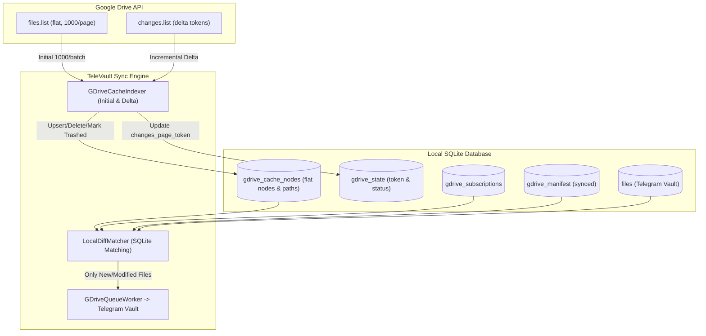

# Google Drive Full Local Metadata Cache & Incremental Delta Sync Design

**Date:** 2026-09-18  
**Status:** Approved  
**Author:** TeleVault Engineering  

---

## 1. Context & Problem Statement

### 1.1 Current Architecture Limitations
Under the existing implementation of TeleVault Desktop's Google Drive sync:
1. **Expensive Recursive Traversal:** Full scans (`scanNow()`) traverse the Drive hierarchy by recursively calling `listFolder(folderId)` for every directory in active subscriptions. For Drive accounts containing thousands of folders and files, this consumes hundreds to thousands of HTTP roundtrips, resulting in latency (minutes) and triggering Google Drive API rate limits (`403 User Rate Limit Exceeded`).
2. **Missing Local Snapshot:** While successfully synced files are recorded in `gdrive_manifest`, there is no local offline representation of the user's remote Drive structure. Consequently, subscriptions must continually re-query remote Drive endpoints to discover new or modified files.
3. **Redundant Network Calls on Scan:** Any manual rescan or subscription change forces remote tree traversal rather than instant local diff calculation.

### 1.2 Objectives
- Implement a **Full Drive Local Metadata Cache** (`gdrive_cache_nodes`) in SQLite.
- Provide fast initial indexing via flat batch pagination (`pageSize=1000`), reducing 50,000 files to ~50 HTTP requests (~5-10s).
- Maintain cache fresh via **Google Drive Changes API** delta streaming (`changes.list?pageToken=...`).
- Execute all sync checks, folder queries, and queue additions **completely offline in SQLite** in milliseconds, with zero Google API roundtrips during normal rescan operations.
- Handle all identified edge cases: Google Workspace documents, duplicate names in the same folder, Unicode NFC normalization, shortcuts, and expired change tokens (`410 Gone`).

---

## 2. Architecture & Data Flow



---

## 3. SQLite Database Schema: `gdrive_cache_nodes`

### 3.1 Table Definition & Indices
Added to [`electron/lib/db/indexDb.js`](file:///Users/admin/Documents/Projects/televault-desktop/electron/lib/db/indexDb.js):

```sql
CREATE TABLE IF NOT EXISTS gdrive_cache_nodes (
  id TEXT PRIMARY KEY,
  parent_id TEXT,
  name TEXT NOT NULL,
  mime_type TEXT NOT NULL,
  is_folder INTEGER NOT NULL DEFAULT 0,
  size INTEGER NOT NULL DEFAULT 0,
  modified_time TEXT,
  md5_checksum TEXT,
  trashed INTEGER NOT NULL DEFAULT 0,
  shortcut_target_id TEXT,
  drive_path TEXT,
  cached_at TEXT NOT NULL
);

CREATE INDEX IF NOT EXISTS idx_gdrive_cache_parent ON gdrive_cache_nodes(parent_id);
CREATE INDEX IF NOT EXISTS idx_gdrive_cache_path ON gdrive_cache_nodes(drive_path);
CREATE INDEX IF NOT EXISTS idx_gdrive_cache_sync ON gdrive_cache_nodes(trashed, is_folder);
```

### 3.2 State Variables (`gdrive_state`)
- `cache_status`: `'idle'` | `'indexing'` | `'ready'` | `'error'`
- `cache_total_nodes`: Integer count of cached nodes.
- `cache_last_full_scan`: ISO timestamp of latest complete indexing.
- `changes_page_token`: Persistent token for Google Drive Changes API.

---

## 4. Ingestion & Materialization Algorithms

### 4.1 Flat Batch Ingestion (Initial Indexing)
1. **Fetch Flat Nodes:**
   Query `files.list` with parameters:
   - `q = "trashed = false"`
   - `pageSize = 1000`
   - `fields = "nextPageToken,files(id,name,mimeType,parents,size,modifiedTime,md5Checksum,shortcutDetails)"`
   - `supportsAllDrives = true`
   - `includeItemsFromAllDrives = true`
2. **Transaction Insertion:**
   Each page of 1000 items is inserted within a single `db.transaction()`:
   - Normalize `name` to Unicode NFC: `name.normalize('NFC')`.
   - Store primary parent: `parents?.[0] || 'root'`.
   - Extract `shortcut_target_id = shortcutDetails?.targetId || null`.
   - Emit progress event to UI: `{ indexedCount, status: 'indexing' }`.
3. **Materialize `drive_path`:**
   After all pages are ingested, run in-memory or recursive traversal starting from `root` to construct full, normalized `/parent/child.ext` paths:
   - Detect duplicate sibling names under the same `parent_id` and append numbering: `name (1).ext`, `name (2).ext`.
   - Batch update `drive_path` for all nodes in SQLite.
4. **Acquire Base Changes Token:**
   Call `changes/startPageToken` and persist `changes_page_token`. Set `cache_status = 'ready'`.

### 4.2 Incremental Delta Updates (Changes API)
On regular poll intervals (e.g. 60s) or manual sync:
1. Call `changes.list(pageToken)` with `pageSize = 1000`, `includeRemoved = true`.
2. For each change:
   - If `removed === true` or `file.trashed === true`:
     Update node in `gdrive_cache_nodes` (`trashed = 1`) or delete node.
   - If file created or updated:
     Upsert node in `gdrive_cache_nodes`, resolve `drive_path`, and touch `cached_at`.
3. Persist `newStartPageToken`.
4. **Token Expiration Recovery:**
   If the API returns HTTP 410 (`Gone - Page token is no longer valid`), smoothly clear cache and trigger a fresh Flat Batch Ingestion without crashing.

---

## 5. Local Differential Matching & Queue Enqueuing

When evaluating what needs to sync to Telegram Vault:
1. Retrieve active subscriptions from `gdrive_subscriptions WHERE enabled = 1`.
2. For each folder subscription `sub`:
   Query local SQLite:
   ```sql
   SELECT * FROM gdrive_cache_nodes
   WHERE is_folder = 0
     AND trashed = 0
     AND drive_path LIKE :subPathPrefix
   ```
3. For each candidate node:
   - Check against `gdrive_manifest`:
     - If not in manifest: **enqueue for sync**.
     - If in manifest but `modified_time != manifest.drive_modified_time`: **enqueue for sync**.
     - If in manifest and matching `modified_time`: **skip immediately (0 ms network cost)**.
4. If target vault path already exists in `files` table at matching size and SHA256, mark manifest as synced and avoid re-downloading.

---

## 6. Edge Case Protections

| Edge Case | Impact | Solution |
|---|---|---|
| **Google Workspace Docs** (`application/vnd.google-apps.*`) | Cannot download via `alt=media`, returns 403 | Filter out binary download for docs unless export format specified; exclude from direct sync queue. |
| **Duplicate file names in same Drive folder** | Overwrites in flat path namespace | Auto-deduplicate in path materialization: `filename (1).ext`. |
| **Shortcuts / Symlinks** | Fails download or references wrong target | Read `shortcut_target_id` and resolve to target file's metadata and stream. |
| **Unicode NFD (macOS) vs NFC (Drive/Linux)** | Comparison fails even though strings look identical | Always apply `.normalize('NFC')` upon ingestion and path lookup. |
| **Token Expired (HTTP 410)** | Polling breaks permanently | Catch 410, purge stale token, trigger fast re-index. |
| **Telegram Flood Wait (420)** | Disk fills up with downloaded temp files | Pause download workers whenever Telegram flood wait is active. |

---

## 7. Verification Strategy

1. **Unit Tests (`electron/lib/gdrive/__tests__/`):**
   - Ingestion tests with mock pages of 1,000 files.
   - Path resolution tests including nested directories and duplicate sibling names.
   - Delta change application tests (insert, rename, trash, move).
   - Token expiration 410 error recovery test.
   - Differential query matching tests comparing cache against manifest.
2. **Integration Verification:**
   - Full `npm run build` verification.
   - End-to-end service mock test confirming zero network calls during steady-state polling.
