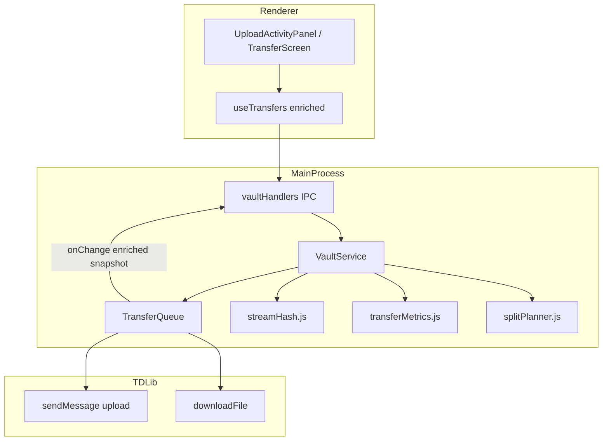

# TeleVault Desktop — Transfer Improvements Design

> Port các pattern upload/download tốt nhất từ TeleVault-elpideus sang televault-desktop (Electron + TDLib).

**Ngày:** 2026-07-16  
**Trạng thái:** Approved for implementation (user request: viết plan trực tiếp)

---

## 1. Bối cảnh & mục tiêu

### Hai codebase

| | TeleVault-elpideus | televault-desktop |
|---|---|---|
| **Kiến trúc** | Web app: React → FastAPI → Telethon → Telegram | Electron: React → IPC → TDLib → Telegram |
| **Transport** | HTTP multipart / chunked / TUS → server temp → Telegram | TDLib `sendMessage` / `downloadFile` trực tiếp |
| **Metadata** | PostgreSQL (files + splits) | SQLite index + caption JSON |
| **Progress** | XHR + SSE (OperationRegistry) | IPC poll `transfers:changed` (200ms throttle) |

### Mục tiêu

Nâng cấp upload/download của **televault-desktop** bằng cách áp dụng các pattern đã được kiểm chứng từ **elpideus**, ưu tiên:

1. **Độ tin cậy** — dedup, stall detection, retry/resume UI
2. **Hiệu năng bộ nhớ** — streaming SHA256 thay vì đọc full file
3. **UX transfer** — speed, ETA, phase labels (hashing → uploading → processing)
4. **File lớn** — split >2GB (giới hạn Telegram) với metadata multi-part
5. **Parity** — shared vault download, folder progress, cache enforcement

### Không port (khác kiến trúc)

- HTTP chunked / TUS upload path (desktop không có backend HTTP)
- SSE progress server (thay bằng IPC push enriched snapshot)
- `fast_upload.py` parallel MTProto chunks (TDLib tự xử lý; chỉ port **split logic** cho file >2GB)
- Multi-account round-robin (desktop single TDLib session; giữ `maxConcurrentTransfers` hiện có)
- Fernet session encryption (desktop dùng TDLib DB key — không liên quan file content)

---

## 2. Phân tích gap (elpideus tốt hơn)

### P0 — Giá trị cao, effort thấp

| Gap desktop | Pattern elpideus | File tham chiếu |
|---|---|---|
| `_sha256Of()` đọc full file vào RAM | Streaming hash 64MB chunks + progress | `frontend/public/hash-worker.js` |
| Progress chỉ có `fraction 0–1` | Speed EMA + ETA + phase status | `frontend/src/store/uploadStore.ts`, `TransferItem.tsx` |
| `retryTransfer`/`resumeTransfer` có code nhưng **không expose IPC/UI** | Cancel/retry/resume trong TransfersTray | `vaultService.js:743-757` |
| Dedup chỉ khi restore | Pre-upload check-hash + skip UI "duplicate" | `upload.py:check_duplicate`, `files.ts` check-hash |
| Không stall detection | 120s không progress → fail attempt | `upload.py:_STALL_TIMEOUT` |
| Folder download progress IPC có, UI không subscribe | Progress per-file trong batch | `fileExport.js` + `vault:downloadFolderProgress` |

### P1 — Giá trị cao, effort trung bình

| Gap desktop | Pattern elpideus | Ghi chú |
|---|---|---|
| Không hỗ trợ file >2GB | Split 2GB (`_SPLIT_SIZE`), parallel upload splits, merge download | Cần mở rộng `captionCodec` + DB |
| `getCacheLimitBytes()` không được gọi | N/A (elpideus temp cleanup) | Enforce evict TDLib cache |
| Shared vault download inline, không SHA verify | Integrity check sau download | Port `_isDownloadAlreadyComplete` |
| Hash nhiều file song song gây RAM spike | `hashSem(1)` — 1 hash at a time | `uploadSemaphores.ts` |

### P2 — Nice to have (ngoài scope phase 1)

- Bandwidth throttle cho Telegram transfers
- Download resume qua HTTP Range (không áp dụng TDLib)
- Cancel all / cancel folder batch

---

## 3. Kiến trúc đề xuất



### Nguyên tắc

1. **Giữ TransferQueue làm orchestrator** — không thay bằng worker pool elpideus
2. **Enrich snapshot tại source** — `TransferTask` mang thêm `bytesDone`, `speedBps`, `phase`
3. **Tách module nhỏ** — `streamHash.js`, `transferMetrics.js`, `splitPlanner.js` thay vì phình `vaultService.js`
4. **Caption v2 cho multi-part** — backward compatible với `CAPTION_VERSION = 1`

---

## 4. Thiết kế chi tiết theo component

### 4.1 Streaming SHA256 (`electron/lib/vault/streamHash.js`)

**Thay thế** `_sha256Of()` hiện tại:

```javascript
// electron/lib/vault/vaultService.js:369-373 — hiện tại
_sha256Of(filePath) {
  hash.update(fs.readFileSync(filePath)); // BAD: full RAM
}
```

**Mới:**

```javascript
async function sha256Stream(filePath, { onProgress, signal }) {
  // fs.createReadStream với highWaterMark 64 * 1024 * 1024
  // crypto.createHash('sha256') incremental
  // onProgress(bytesRead / totalSize) mỗi chunk
}
```

- Upload flow: phase `hashing` (0–5% progress bar) → phase `uploading` (5–100%)
- Dedup check dùng cùng stream hash
- Semaphore: chỉ 1 hash concurrent (port `hashSem(1)`)

### 4.2 Transfer metrics (`electron/lib/transfer/transferMetrics.js`)

Port logic EMA từ `uploadStore.ts:86-116`:

```javascript
function createSpeedTracker() {
  // update(fraction, totalBytes) → { speedBps, etaSeconds }
  // EMA: speed = speed * 0.7 + currentSpeed * 0.3
  // Decay speed về 0 sau 10s không đổi progress
}
```

**Mở rộng `TransferTask`:**

| Field | Type | Mô tả |
|---|---|---|
| `phase` | `'hashing' \| 'uploading' \| 'downloading' \| 'verifying' \| 'done'` | Label UI |
| `bytesDone` | `number` | Bytes thực tế |
| `speedBps` | `number` | Smoothed bytes/sec |
| `etaSeconds` | `number \| null` | `(totalBytes - bytesDone) / speedBps` |

**Mở rộng `snapshot()`:**

```javascript
{
  id, kind, label, status, progress, error, metadata,
  phase, bytesDone, totalBytes, speedBps, etaSeconds
}
```

### 4.3 Pre-upload deduplication

Trước `enqueueUpload()`:

1. Stream hash local file
2. Tìm entry trong DB: `path === destPath && sha256 match && size match`
3. Nếu match → return `{ skipped: true, reason: 'duplicate' }` — không enqueue
4. UI hiển thị toast "File đã có trên vault"

Port logic `_isUploadAlreadyOnVault` (đã có) ra bước **trước** queue, không chỉ restore.

### 4.4 Stall detection

Trong `_awaitUploadComplete` và `_runDownload`:

- Track `lastProgressAt` timestamp
- Nếu >120s không có `updateFile` progress mới → reject với `Error('Upload stalled')`
- TransferQueue retry (max 3, backoff 2s/4s/6s) — đã có

### 4.5 Retry / Resume / Pause UI

**IPC mới** (expose code sẵn có):

| IPC | Handler | Gọi |
|---|---|---|
| `vault:retryTransfer` | `vaultHandlers.js` | `vault.retryTransfer(task)` |
| `vault:resumeTransfer` | `vaultHandlers.js` | `vault.resumeTransfer(task)` |
| `vault:pauseTransfer` | mới | set status `paused`, abort running |

**UI** (`UploadActivityPanel.jsx`, `TransferScreen.jsx`):

- Failed → nút Retry
- Paused → nút Resume
- Running → nút Cancel (đã có)
- Hiển thị: `{speed}/s · ETA {eta}` (port `TransferItem.tsx` tooltip)

### 4.6 Large file splitting (>2GB)

**Giới hạn Telegram:** 2GB (4GB Premium). Desktop hiện gửi 1 message/document — fail silent hoặc TDLib error.

**Thiết kế multi-part (port elpideus `_SPLIT_SIZE = 2_097_152_000`):**

#### Caption v2

```json
{
  "v": 2,
  "path": "/folder/big.iso",
  "size": 5000000000,
  "sha256": "abc...",
  "mtime": "2026-07-16T...",
  "parts": [
    { "messageId": 123, "offset": 0, "size": 2097152000 },
    { "messageId": 124, "offset": 2097152000, "size": 2097152000 },
    { "messageId": 125, "offset": 4194304000, "size": 805696000 }
  ]
}
```

- Message đầu tiên mang caption v2 (manifest)
- Các part còn lại: caption `{ "v": 2, "partOf": "<manifestMessageId>", "index": N }`
- `decodeCaption` v2 → `VaultEntry` với `parts[]`

#### Upload flow

1. `splitPlanner.planSplits(fileSize)` → array `{ offset, size, partIndex }`
2. Upload part 0 với manifest caption
3. Upload parts 1..N parallel (bounded by `maxConcurrentTransfers`)
4. Rollback: nếu part N fail → delete uploaded messages (port rollback pattern)

#### Download flow

1. Detect entry có `parts[]`
2. Download từng part qua TDLib → write vào đúng offset (`fs.createWriteStream` với `{ start: offset }`)
3. Verify SHA256 toàn file sau merge
4. Progress: weighted by part sizes

#### DB

- Không cần bảng splits riêng (khác elpideus) — metadata trong caption đủ cho desktop single-user
- `indexDb.upsert` lưu `parts` JSON column (optional migration)

### 4.7 Folder download progress

Wire UI subscribe `vault.onDownloadFolderProgress`:

```javascript
// preload.js — đã expose?
onDownloadFolderProgress(callback) → { current, total, fileName }
```

`VaultShell` / `BrowserScreen`: progress bar khi export folder.

### 4.8 Cache limit enforcement

`indexDb.getCacheLimitBytes()` đọc setting `cache_limit_gb`.

Sau mỗi download complete:

1. Tính tổng size TDLib cache dir
2. Nếu > limit → evict LRU files không có active transfer (dựa trên `local_path` + `last_access`)

### 4.9 Shared vault parity

Refactor `vaultHandlers.js` shared vault download:

- Dùng `TransferQueue` + persist (optional, lower priority)
- SHA256 verify sau download (bắt buộc)
- Không duplicate TDLib download logic inline

---

## 5. Data flow

### Upload (file 100MB — không split)

```
User pick file
  → IPC vault:uploadPaths
  → sha256Stream (phase: hashing, progress 0-5%)
  → checkDuplicate → skip or continue
  → TransferQueue.add
  → _runUpload: sendMessage + updateFile (phase: uploading, 5-100%)
  → indexDb.upsert
  → status: done
```

### Upload (file 5GB — split)

```
User pick file
  → sha256Stream
  → splitPlanner → 3 parts
  → enqueue 3 upload tasks (linked via metadata.partGroupId)
  → part 0: manifest caption v2
  → parts 1-2: partOf captions
  → all done → single VaultEntry in DB
```

### Download

```
User click download
  → enqueueDownload
  → if entry.parts → multiPartDownload
  → else → single TDLib downloadFile
  → sha256 verify (phase: verifying)
  → copyToSaveDirectory
```

---

## 6. Error handling

| Scenario | Hành vi |
|---|---|
| File local không tồn tại | `failed`, message rõ, không retry |
| Upload stall 120s | Retry (max 3), then `failed` |
| TDLib FloodWait | Propagate error, retry with backoff |
| Duplicate file | Skip upload, toast info |
| Part upload partial fail | Rollback uploaded parts, `failed` |
| SHA mismatch after download | `failed`, delete corrupt local file |
| Cache full | Evict LRU before new download |

---

## 7. Testing strategy

| Layer | Tests |
|---|---|
| `streamHash.js` | Unit: hash match `crypto.createHash` sync on small file |
| `transferMetrics.js` | Unit: EMA speed, ETA calculation |
| `splitPlanner.js` | Unit: 5GB → 3 splits, edge 2GB exactly |
| `captionCodec v2` | Unit: encode/decode roundtrip, v1 backward compat |
| `VaultService` | Integration mock TDLib: stall timeout, dedup skip |
| UI | Manual: retry/resume, speed display, folder progress |

Chạy: `npm test` trong `packages/televault-core` và `electron/lib/**/__tests__`.

---

## 8. Phased rollout

### Phase 1 (P0) — ~3-5 ngày
Streaming hash, transfer metrics, dedup upfront, stall detection, retry/resume UI, folder progress wire-up

### Phase 2 (P1) — ~5-7 ngày
Multi-part >2GB upload/download, caption v2, cache enforcement

### Phase 3 (P2) — backlog
Shared vault refactor, bandwidth throttle, cancel batch

---

## 9. Rủi ro & mitigations

| Rủi ro | Mitigation |
|---|---|
| Caption v2 break index cũ | `decodeCaption` fallback v1; migration không cần |
| Split rollback miss message | Track uploaded messageIds trong task metadata |
| TDLib không resume mid-upload | Accept: retry whole part (same as elpideus chunked non-TUS) |
| Memory vẫn spike khi multi-part parallel | Bound concurrent parts = `maxConcurrentTransfers` |

---

## 10. Files chính sẽ thay đổi

**Tạo mới:**
- `electron/lib/vault/streamHash.js`
- `electron/lib/transfer/transferMetrics.js`
- `electron/lib/vault/splitPlanner.js`
- `electron/lib/vault/multiPartUpload.js`
- `electron/lib/vault/multiPartDownload.js`
- `packages/televault-core/src/captionCodec.v2.js` (hoặc mở rộng file hiện có)

**Sửa:**
- `electron/lib/vault/vaultService.js`
- `electron/lib/transfer/transferQueue.js`
- `electron/lib/ipc/vaultHandlers.js`
- `electron/preload.js`
- `src/hooks/useTransfers.js`
- `src/components/UploadActivityPanel.jsx`
- `src/screens/TransferScreen.jsx`
- `packages/televault-core/src/captionCodec.js`

**Tham chiếu elpideus (read-only):**
- `backend/app/services/upload.py` — split, stall, rollback, dedup
- `frontend/src/store/uploadStore.ts` — speed EMA
- `frontend/public/hash-worker.js` — streaming hash pattern
- `frontend/src/themes/default/components/TransferItem.tsx` — ETA UI
